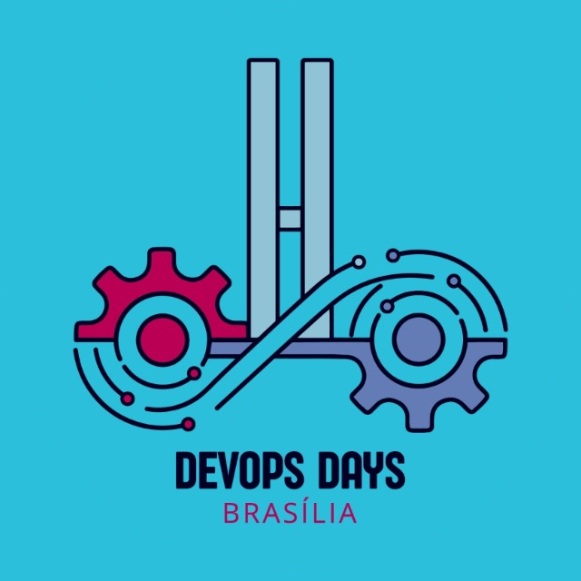

# Talos Linux: um OS minimalista e sem SSH para o Kubernetes

Slides da palestra apresentada no **DevOps Days Brasília 2026**.

Módulo Terraform/OpenTofu citado nos slides: [`silvemerson/terraform-proxmox-talos-linux-cluster`](https://github.com/silvemerson/terraform-proxmox-talos-linux-cluster).
Roteiro da demo ao vivo: [`demo.md`](demo.md).

---



> `logos/event-logo.png` é o logo do evento. O logo da 4Linux fica em
> `4linux-logo/logo-4linux.png` e já aparece no rodapé de todo slide.

## Estrutura

```
slides.md          # conteúdo dos slides (Marp)
slides.html        # HTML de conferência gerado a partir do slides.md
demo.md            # roteiro de comandos da demo ao vivo
images/            # diagramas do Talos, QR codes e logos de comunidade
logos/             # logo do evento
4linux-logo/       # logo da 4Linux (rodapé)
eu-rsrs/           # foto do palestrante (slide de whoami)
```

## Como usar os slides

### Pré-requisito

```bash
npm install -g @marp-team/marp-cli
```

### Visualizar no browser com live reload

```bash
marp --watch slides.md
```

### Abrir o HTML já gerado

```bash
xdg-open slides.html
```

### Exportar para PDF

```bash
marp slides.md --pdf --allow-local-files -o slides.pdf
```

> `--allow-local-files` é necessário para carregar imagens e logos locais.

### Exportar para HTML

```bash
marp slides.md --html --allow-local-files -o slides.html
```
