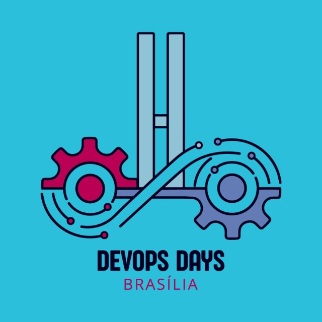
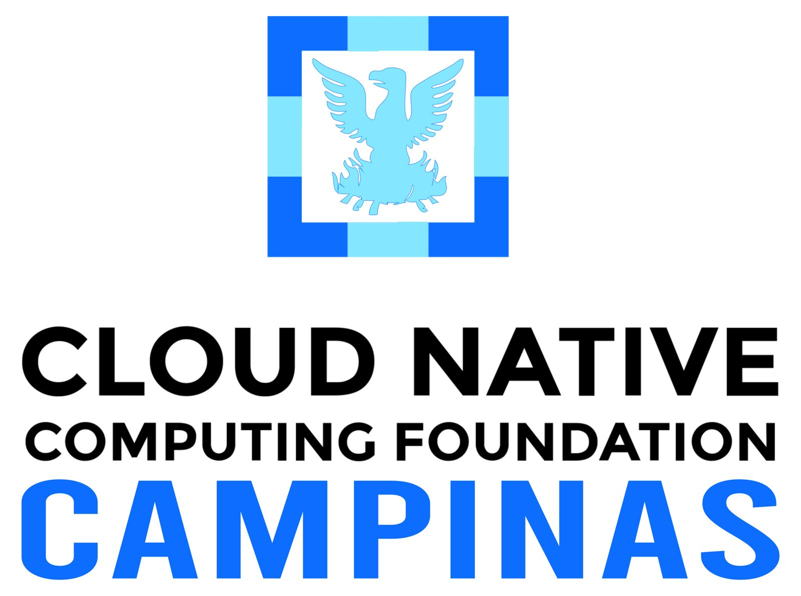
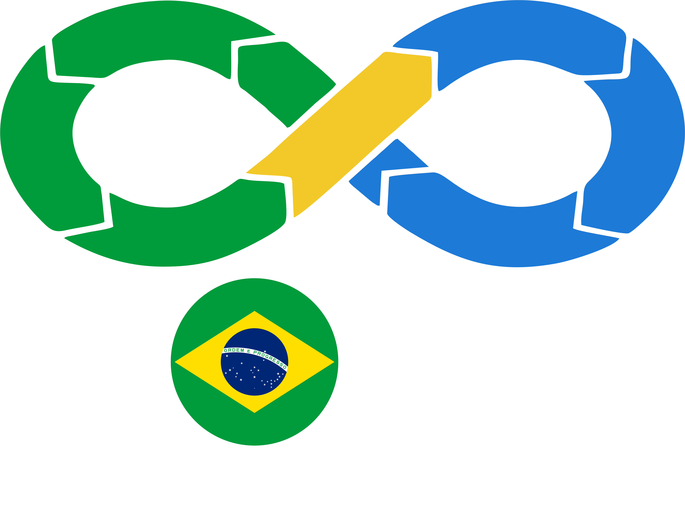
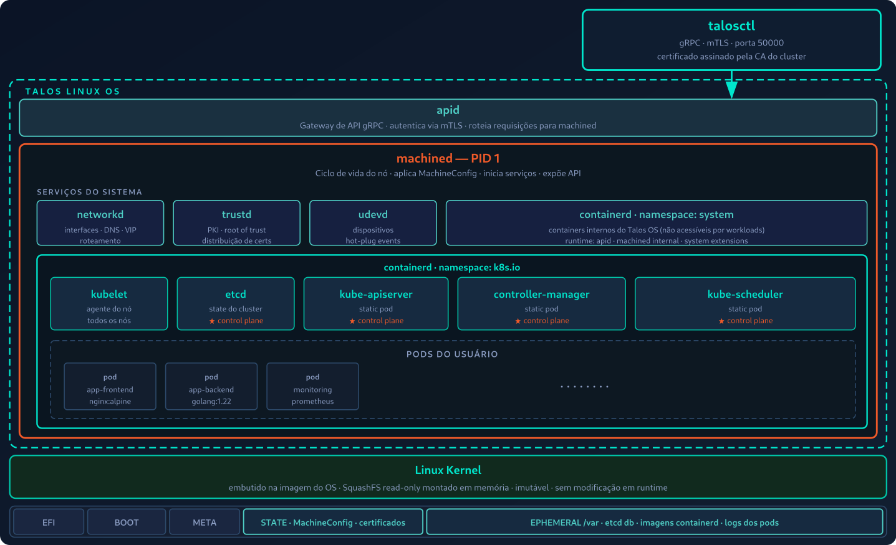
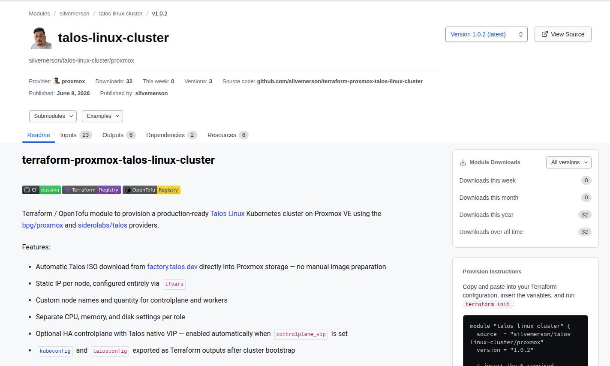
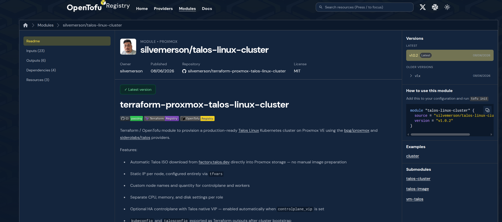

<!-- _paginate: false -->
<!-- _footer: "" -->
<style scoped>
section {
  display: flex;
  flex-direction: column;
  justify-content: space-between;
  padding: 50px 70px;
  text-align: left;
}
.tag {
  align-self: flex-start;
  background: rgba(0, 230, 204, 0.12);
  border: 1px solid rgba(0, 230, 204, 0.45);
  color: #00E6CC;
  padding: 6px 16px;
  border-radius: 20px;
  font-size: 0.7em;
  font-weight: 700;
}
.content { display: flex; justify-content: space-between; align-items: center; gap: 40px; }
h1 { font-size: 2.2em; line-height: 1.2; margin: 0 0 20px 0; color: #F8FAFC; text-align: left; }
.highlight { color: #00E6CC; }
.speaker { margin-top: 25px; border-left: 4px solid #00E6CC; padding-left: 15px; }
.logo-card { border-radius: 18px; border: 3px solid rgba(0, 230, 204, 0.5); box-shadow: 0 0 40px rgba(0, 230, 204, 0.2); line-height: 0; overflow: hidden; }
.logo-card img { display: block; }
.footer {
  display: flex;
  justify-content: space-between;
  align-items: center;
  border-top: 1px solid rgba(255, 255, 255, 0.1);
  padding-top: 14px;
  font-size: 0.7em;
  color: #8B9DC3;
}
</style>

<div class="tag">DevOps Days Brasília 2026</div>

<div class="content">
<div>
<h1>Talos Linux: um OS<br><span class="highlight">minimalista e sem SSH</span><br>para o Kubernetes</h1>

<div class="speaker">
<strong style="font-size: 1.2em; color: #F8FAFC;">Emerson Silva</strong>
</div>
</div>

<div class="logo-card"></div>
</div>

<div class="footer">
<span>Cloud Native &amp; Open Source Infrastructure</span>

</div>

---
<!-- _paginate: false -->
<style scoped>
section {
  display: flex;
  flex-direction: row;
  justify-content: flex-start;
  align-items: center;
  gap: 50px;
}
.wi-photo {
  flex-shrink: 0;
  width: 230px;
  height: 230px;
  object-fit: cover;
  border-radius: 20px;
  border: 3px solid rgba(0, 230, 204, 0.35);
  box-shadow: 0 0 30px rgba(0, 230, 204, 0.15);
}
</style>

<div>

# 🇧🇷 Emerson Silva

* Engenheiro DevOps na **4Linux**
* +9 anos em ambientes DevOps críticos
* Foco em **Kubernetes**, IaC e confiabilidade
* Palestrante, instrutor,escritor , ex-zagueiro 
* Community Lead de Kubernetes na DOUGBrazil
* Organizador do CNCF Campinas

</div>

<div style="display:flex; flex-direction:column; align-items:center; gap:20px;">
  
  <div style="display:flex; align-items:center; gap:24px;">
    
    
  </div>
</div>

---
<!-- _paginate: false -->
<!-- _footer: "" -->
<style scoped>
section { padding: 50px 60px 70px 60px; text-align: center; }
h2 { font-size: 1.4em; color: #8B9DC3; font-weight: 400; margin-bottom: 0.3em; letter-spacing: 0.05em; text-transform: uppercase; }
h2::before { display: none; }
p { font-size: 0.85em; color: #c8d4e8; line-height: 1.6; max-width: 72%; margin: 0 auto 1.6em auto; text-align: center; }
.timeline { display: flex; align-items: flex-start; gap: 0; width: 100%; margin-top: 0.5em; position: relative; }
.timeline::before { content: ""; position: absolute; top: 22px; left: 0; right: 0; height: 2px; background: linear-gradient(90deg, #00E6CC, #4ECDC4, #f15a29); }
.tl-item { flex: 1; text-align: center; position: relative; padding-top: 40px; }
.tl-item::before { content: ""; position: absolute; top: 16px; left: 50%; transform: translateX(-50%); width: 12px; height: 12px; border-radius: 50%; background: #00E6CC; border: 2px solid #0B1426; z-index: 1; }
.tl-year { font-size: 0.9em; font-weight: 700; color: #00E6CC; display: block; }
.tl-label { font-size: 0.6em; color: #8B9DC3; display: block; margin-top: 2px; line-height: 1.2; }
</style>


Fundada em 2001, a 4Linux participou das principais transformações da área de tecnologia. Começamos com Linux e software livre, navegamos por Cloud, DevOps e Containers — e hoje atuamos com agentes de IA, sempre com base em **inovação aberta**.

<div class="timeline">
  <div class="tl-item"><span class="tl-year">2001</span><span class="tl-label">Linux &<br>Software Livre</span></div>
  <div class="tl-item"><span class="tl-year">2008</span><span class="tl-label">DevOps</span></div>
  <div class="tl-item"><span class="tl-year">2016</span><span class="tl-label">Containers &<br>Kubernetes</span></div>
  <div class="tl-item"><span class="tl-year">2019</span><span class="tl-label">Machine<br>Learning</span></div>
  <div class="tl-item"><span class="tl-year">2020</span><span class="tl-year" style="color:#4ECDC4">Cloud</span></div>
  <div class="tl-item"><span class="tl-year">2024+</span><span class="tl-label">IA com<br>Open Source</span></div>
</div>


---
<!-- _paginate: false -->

## O que veremos hoje

1. O problema com o OS tradicional
2. O que é o Talos Linux
3. A filosofia por trás do design
4. Arquitetura por dentro
5. Segurança e atualizações
6. Onde ele roda: plataformas suportadas
7. Armazenamento no Talos
8. Contribuindo com o ecossistema
9. Demo ao vivo
10. Quando faz sentido usar

---

## O problema com o OS tradicional

* Gerenciamento manual de pacotes e atualizações
* SSH aberto = superfície de ataque enorme
* Scripts de cloud-init frágeis
* Configuração manual de hardening
* **"Servidor que ninguém sabe como foi configurado"**

---

## O que é o Talos Linux?

* OS **atômico e modular** construído exclusivamente para Kubernetes
* Sem SSH · Sem shell · Sem pacotes desnecessários
* Gerenciado por **API gRPC declarativa** via `talosctl`
* Sistema de arquivos **imutável** (SquashFS read-only em memória)
* Imagem com menos de **80MB**
* `machined` como **PID 1** — escrito em Go do zero
* A mesma imagem roda em **bare metal, cloud ou VM** — sem distro-specific tuning

---
<style scoped>
section {
  display: flex;
  flex-direction: row;
  justify-content: center;
  align-items: center;
  gap: 50px;
}
.talos-logo-wrap {
  flex: 0 0 34%;
  display: flex;
  align-items: center;
  justify-content: center;
}
.talos-logo-wrap img {
  width: 100%;
  max-width: 300px;
}
</style>

<div class="talos-logo-wrap">
  
</div>

<div>

## A filosofia do Talos

* **Distribuído** — HA por design, sem SPOF
* **Imutável** — sempre roda de SquashFS, zero configuration drift
* **Minimal** — sem shell, sem GNU utils, sem busybox
* **Efêmero** — tudo é reconstruível
* **Seguro** — sem senhas, mTLS, certificados auto-rotativos
* **Declarativo** — um único YAML para tudo
* **Cattle, not pets** — nós substituídos, nunca reparados

</div>

---
<!-- _footer: "" -->
<style scoped>
section {
  padding: 20px;
}
</style>



---

## Sem SSH. Sem shell. Sério.

```bash
# Tentativa de acesso via SSH
ssh root@192.168.121.72
# ssh: connect to host 192.168.121.72 port 22: Connection refused

# A forma correta: API via talosctl
talosctl -n 192.168.121.72 get members
talosctl -n 192.168.121.72 dashboard
talosctl -n 192.168.121.72 logs machined
```

> Toda interação acontece via API gRPC autenticada por certificado

---

## Arquitetura do sistema de arquivos

| Partição | Ponto de montagem | Conteúdo |
|----------|-------------------|----------|
| **EFI** | — | Dados de boot EFI |
| **BOOT** | — | Bootloader, initramfs, kernel |
| **STATE** | `/system/state` | MachineConfig, certificados |
| **EPHEMERAL** | `/var` | Dados do K8s, containerd, etcd, logs |

* Raiz: **SquashFS read-only** montado em memória
* Sem instalação de pacotes em runtime
* Reset = disco limpo e cluster de volta em minutos
* `/var` sobrevive a reboots, mas é apagado em `reset` sem `--preserve`

---
<style scoped>
section {
  padding: 45px 60px;
}
h2 {
  font-size: 1.7em;
  margin-bottom: 0.5em;
}
li {
  margin-bottom: 0.35em;
}
section pre {
  padding: 0.5em 1.2em;
  margin: 0.4em 0;
}
section pre code {
  font-size: 0.72em;
}
blockquote {
  font-size: 0.85em;
  margin-top: 0.4em;
}
</style>

## etcd: imutável por baixo dos panos

* etcd roda como **static pod**, no `containerd` namespace `k8s.io`
* Binário e configuração vêm da **imagem imutável** (SquashFS) — nunca editados à mão
* Só o **datastore** é mutável, isolado na partição `EPHEMERAL` (`/var`)
* Sem `etcdctl` via SSH: bootstrap, membros e snapshots só via `talosctl`

```bash
talosctl etcd members
talosctl etcd snapshot db.snapshot
```

> Mesmo princípio do resto do Talos: infraestrutura declarada, não configurada à mão.

---

## Init system: machined vs systemd

| | Linux Tradicional | Talos Linux |
|--|--|--|
| **PID 1** | `systemd` | `machined` |
| **Função** | Gerencia serviços | Ciclo de vida completo do nó |
| **Serviços** | Units .service | `containerd` + `kubelet` via API |
| **Configuração** | `/etc/systemd/` | MachineConfig YAML |
| **Acesso** | `systemctl` + SSH | `talosctl` via gRPC |

> `machined` monta o FS, aplica a config, inicia os serviços e expõe a API — tudo sem shell

---

## Configuração declarativa
<!-- _footer: "" -->
<style scoped>
section pre code {
  font-size: 0.68em;
  line-height: 1.35;
}
section pre {
  padding: 0.7em 1.2em;
  margin: 0.4em 0;
}
</style>

```yaml
# Um único YAML define tudo
machine:
  network:
    interfaces:
      - deviceSelector:
          physical: true
        dhcp: true
        vip:
          ip: 192.168.121.100
cluster:
  network:
    cni:
      name: flannel
```

> Sem scripts procedurais. Sem configuração manual.
> Estado do cluster = arquivo em Git.

---

## Segurança por design: mTLS

```
talosctl → [certificado cliente] → API Talos
              ↕ mTLS bidirecional
           [CA do cluster] ← autentica ambos os lados
```

* Toda chamada à API exige **certificado assinado pela CA do cluster**
* Permissões **granulares por certificado** (ex: read-only para monitoramento)
* Sem SSH = sem `CVE-2024-6387` (regreSSHion) e similares
* Sem `apt`/`yum` = sem instalação de malware ou backdoors em runtime
* **Superfície de ataque mínima**: shell, gerenciadores de pacotes e SSH removidos por design

---

## Atualizações atômicas com boot A/B

```bash
# Atualiza o nó para uma nova versão do Talos
talosctl upgrade --nodes 192.168.121.72 \
  --image ghcr.io/siderolabs/installer:v1.9.0
```

* **Kernel embutido na imagem** — userspace e kernel sempre compatíveis
* Sistema de boot **A/B**: slot ativo e slot de standby
* Falha no upgrade → **rollback automático** para a versão anterior
* Atualizar o kernel = substituir a imagem completa do sistema
* Zero drift: o SO é sempre idêntico ao que foi testado

---

## Onde o Talos roda hoje

| Categoria | Plataformas |
|---|---|
| Cloud pública | AWS, Azure, GCP |
| Virtualização / Bare metal | Bare metal, Proxmox/KVM (libvirt), VMware |
| Cloud alternativa | DigitalOcean, Hetzner, Scaleway |
| Desenvolvimento local | Docker (`talosctl cluster create docker`) |

> Mesma imagem imutável, o mesmo `machined`, a mesma API — o hardware muda, o SO não.

---
<style scoped>
section {
  padding: 35px 60px;
}
h2 {
  margin-bottom: 0.4em;
}
.company-grid {
  display: grid;
  grid-template-columns: repeat(3, 1fr);
  gap: 0.8rem;
  margin-top: 0.6em;
}
.company-grid .card {
  background: rgba(26, 26, 26, 0.6);
  border: 1px solid rgba(0, 230, 204, 0.2);
  border-radius: 12px;
  padding: 0.8rem 1.1rem;
}
.company-grid .card strong {
  display: block;
  font-size: 1.05em;
  margin-bottom: 0.25em;
}
.company-grid .card span {
  font-size: 0.68em;
  color: #c8d4e8;
  line-height: 1.3;
}
blockquote {
  font-size: 0.8em;
  margin-top: 0.6em;
}
</style>

## Quem usa Talos Linux em produção

<div class="company-grid">
  <div class="card"><strong>Nokia</strong><span>Roda uma das maiores clouds privadas do mundo</span></div>
  <div class="card"><strong>Equinix</strong><span>Migrou do Kubespray pra reduzir tempo de deploy</span></div>
  <div class="card"><strong>SNCF</strong><span>Ferrovia nacional da França foi cloud native em 4 meses</span></div>
  <div class="card"><strong>Civo</strong><span>Cloud pública rodando inteiramente sobre Talos</span></div>
  <div class="card"><strong>JYSK</strong><span>3.400 deployments de edge em produção</span></div>
  <div class="card"><strong>Ursa Major</strong><span>Kubernetes aplicado a foguetes — sim, literalmente</span></div>
</div>

> Case studies públicos em siderolabs.com/case-studies

---

## Armazenamento: opções CSI recomendadas

| Solução | Caso de uso | Destaque |
|---------|-------------|----------|
| **Longhorn** | Simplicidade / KubeVirt | Redundância + LiveMigration |
| **Rook + Ceph** | Escala / larga escala | Escala "infinita", mais complexo |
| **OpenEBS Mayastor** | Alta performance | NVMe-TCP, baixa latência |
| **AWS EBS / GCP PD** | Nuvem | CSI nativo do provedor |
| **NFS / iSCSI** | Bare metal / on-prem | `nfs-subdir-external-provisioner` |

---

## Dimensionamento de armazenamento

* **Control plane**: mínimo **40GB** por nó (etcd reside na partição `EPHEMERAL`)
* Clusters com **100+ nós**: mesma base, mas monitoramento contínuo é essencial
* `talosctl reset` apaga `/var` — use `--preserve` para manter dados do etcd
* Evite rodar workloads pesadas nos **mesmos nós** que processam armazenamento

```bash
# Diagnóstico de armazenamento sem SSH
talosctl -n 192.168.121.72 read /proc/mounts
talosctl -n 192.168.121.72 dmesg | grep -i disk
```

---
<!-- _footer: "" -->
<style scoped>
section {
  display: flex;
  flex-direction: column;
  padding: 30px 60px;
  font-size: 20px;
}
h2 {
  margin-bottom: 0.4em;
}
p {
  margin-bottom: 0.5em;
}
.registry-grid {
  display: flex;
  gap: 30px;
  margin-top: 0.3em;
}
.registry-grid figure {
  flex: 1;
  margin: 0;
  text-align: center;
}
.registry-grid img {
  width: 100%;
  max-height: 260px;
  object-fit: contain;
  border-radius: 10px;
  border: 1px solid rgba(0, 230, 204, 0.25);
  box-shadow: 0 0 20px rgba(0, 230, 204, 0.1);
  background: #060e1a;
}
.registry-grid figcaption {
  margin-top: 0.4em;
  font-size: 0.8em;
  color: #8B9DC3;
}
blockquote {
  margin-top: 0.6em;
}
</style>

## Contribuindo com o ecossistema

Publiquei o módulo `silvemerson/talos-linux-cluster` para provisionar clusters Talos Linux em Proxmox via Terraform/OpenTofu — disponível nos dois registries oficiais.

<div class="registry-grid">
  <figure>
    
    <figcaption>Terraform Registry</figcaption>
  </figure>
  <figure>
    
    <figcaption>OpenTofu Registry</figcaption>
  </figure>
</div>

> ISO automática via `factory.talos.dev`, HA com VIP nativo, `kubeconfig`/`talosconfig` como outputs

---
<!-- _paginate: false -->
<style scoped>
section {
  display: flex;
  justify-content: center;
  align-items: center;
  height: 100%;
  text-align: center;
}
h2 {
  font-size: 3rem;
  color: #00E6CC;
  text-shadow: 0 0 20px rgba(0, 230, 204, 0.5);
}
</style>

## 🖥️ Demo ao vivo

---

## Quando usar o Talos Linux?

* ✅ Clusters Kubernetes em produção
* ✅ Ambientes que exigem hardening e compliance
* ✅ Infraestrutura GitOps e declarativa
* ✅ Bare metal, AWS, Azure, GCP, Proxmox/VMware ou homelab
* ✅ Times que querem reduzir overhead operacional
* ✅ Armazenamento com Longhorn, Rook/Ceph ou OpenEBS via CSI

* ⚠️ Não é para workloads que precisam de SSH direto ao node
* ⚠️ Curva de aprendizado inicial existe (mas vale a pena)

---

<!-- _footer: "" -->
<style scoped>
table { font-size: 0.72em; width: 100%; }
th { background: rgba(0,230,204,0.12); color: #00E6CC; padding: 6px 14px; }
td { padding: 5px 14px; border-bottom: 1px solid rgba(255,255,255,0.06); }
tr:last-child td { border-bottom: none; }
</style>

## Comparando com o tradicional

| | Ubuntu / CentOS | Talos Linux |
|--|--|--|
| Acesso | SSH + shell bash | API gRPC · `talosctl` |
| PID 1 | `systemd` | `machined` |
| Tamanho | ~1 GB+ | ~80 MB |
| Gestão | Manual / Ansible | Declarativa via YAML |
| Sistema de arquivos | Mutável | SquashFS read-only |
| Atualizações | `apt upgrade` incremental | Atômica A/B + rollback |
| mTLS | ❌ | ✅ nativo |
| Config drift | Frequente | Impossível |
| Superfície de ataque | Alta | Mínima |

---
<!-- _paginate: false -->
<style scoped>
section {
  padding: 60px;
  display: flex;
  flex-direction: column;
}

h2 {
  font-size: 2.2em;
  color: #00C4A7;
  font-weight: 600;
  margin-bottom: 2rem;
  position: relative;
}

h2::before {
  content: "";
  position: absolute;
  left: -25px;
  top: 50%;
  transform: translateY(-50%);
  width: 4px;
  height: 50px;
  background: linear-gradient(135deg, #00E6CC, #4ECDC4);
  border-radius: 2px;
}

ul {
  list-style: none;
  margin: 0;
  padding: 0;
  display: grid;
  grid-template-columns: repeat(3, 1fr);
  gap: 1.5rem;
  margin-bottom: 0.1rem;
}

li {
  background: rgba(26, 26, 26, 0.6);
  border: 1px solid rgba(0, 230, 204, 0.2);
  border-radius: 12px;
  padding: 1.5rem;
  text-align: center;
  position: relative;
  margin-bottom: 0;
}

li::before {
  content: "";
  position: absolute;
  top: 0;
  left: 0;
  right: 0;
  height: 3px;
  background: linear-gradient(90deg, #00E6CC 0%, #f15a29 100%);
  border-radius: 12px 12px 0 0;
}

li:nth-child(1)::after { content: "01"; }
li:nth-child(2)::after { content: "02"; }
li:nth-child(3)::after { content: "03"; }

li::after {
  position: absolute;
  top: 1rem;
  left: 50%;
  transform: translateX(-50%);
  font-size: 1.6rem;
  color: #f15a29;
  font-weight: 800;
}

li { padding-top: 4rem; }

strong { color: #00E6CC; font-weight: 700; }

.final-message {
  background: linear-gradient(135deg, rgba(0, 230, 204, 0.1), rgba(241, 90, 41, 0.1));
  border: 2px solid rgba(0, 230, 204, 0.3);
  border-radius: 12px;
  padding: 0.5rem 2rem;
  text-align: center;
  margin-top: 2rem;
}

.final-message p {
  font-size: 1.0rem;
  color: #F8FAFC;
  font-weight: 500;
  margin: 0;
}

.final-message strong { color: #00E6CC; font-weight: 700; }
</style>

## Conclusão

* **Experimente** comece com `talosctl cluster create docker`
* **Leia a série** emerson-silva.blog.br
* Seja o próximo a **eliminar SSH** da sua infra

<div class="final-message">
  <p>Infraestrutura <strong>imutável</strong> começa com o primeiro <strong>talosctl apply-config</strong></p>
</div>

---
<!-- _paginate: false -->

## Curso gratuito


### DevOps, AIOps e SRE Fundamentals

Curso gratuito da 4Linux

Escaneie o QR code pra se inscrever

* 🎓 4linux.com.br/cursos

---
<!-- _paginate: false -->
<!-- _footer: "" -->

## Obrigado!


### Contato

* 💻 github.com/silvemerson
* 📖 docs.siderolabs.com
* 📝 emerson-silva.blog.br
* 💬 @silvemerson

Vamos manter contato!


